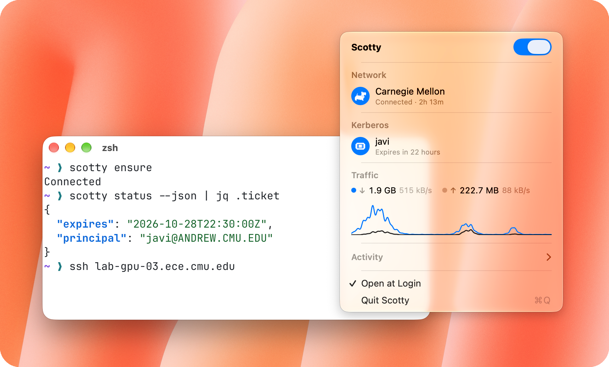
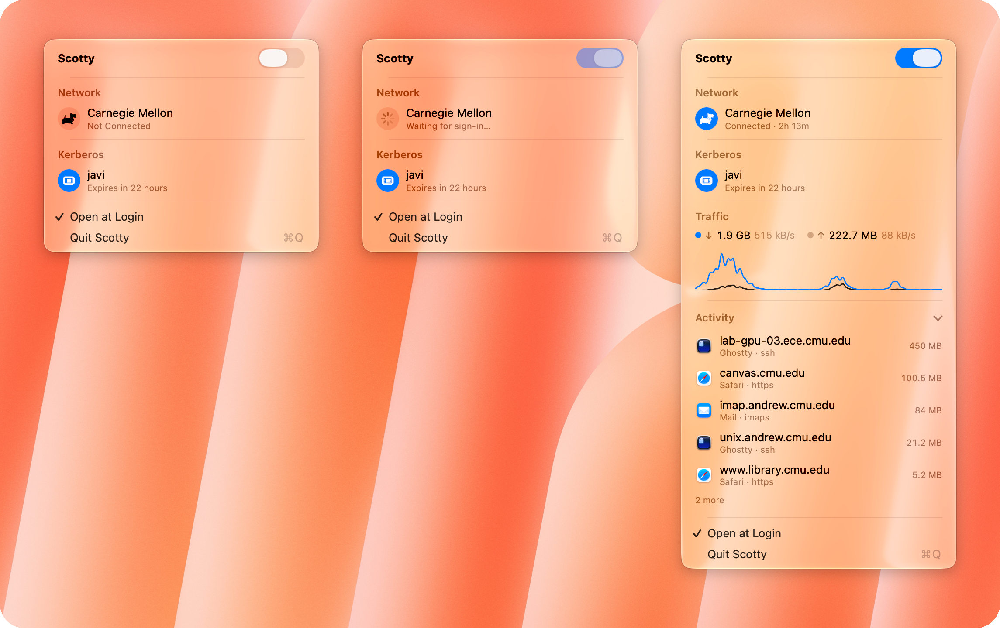

# Scotty

Beam me up to campus. Scotty is a menu bar app and `scotty` CLI for Carnegie Mellon's Campus VPN. It signs in through
CMU single sign-on with Duo, routes only CMU traffic through the tunnel, and keeps your Andrew Kerberos ticket fresh.

<picture>
  <source media="(prefers-color-scheme: dark)" srcset="Images/terminal-dark.png">
  <source media="(prefers-color-scheme: light)" srcset="Images/terminal-light.png">
  
</picture>

## Why

I leave agents running unattended on my Mac, and they need CMU machines and resources. Cisco Secure Client's command
line can't get through CMU's single sign-on, so they had no way to log in or keep the connection up on their own.
Scotty runs while I'm away and gives them a CLI that can.

- Split tunnel only: CMU addresses and DNS zones go through the VPN, everything else stays on your network.
- One click from the menu bar, with your password filled from the Keychain and Duo approved on your phone.
- See the session, ticket, live traffic, and which apps are talking to which CMU hosts.
- Stays up on its own: reconnects after a drop, renews the session before it ends, renews and delegates Kerberos
  tickets to your SSH hosts.
- Scripts and agents get the same access through `scotty`, so a Mac left running keeps reaching the clusters.

<picture>
  <source media="(prefers-color-scheme: dark)" srcset="Images/states-dark.png">
  <source media="(prefers-color-scheme: light)" srcset="Images/states-light.png">
  
</picture>

## Install

Requires an Apple silicon Mac with macOS 15, Xcode and [Homebrew](https://brew.sh).

```sh
brew install openconnect
security add-generic-password -s Scotty -a <andrew-id> -w
./install.sh
```

`install.sh` builds `Scotty.app` into `~/Applications`, links `scotty` into `~/.local/bin`, and asks for your password
once to install the tunnel helper. To pass your Kerberos ticket to SSH hosts, list them one per line in
`~/Library/Application Support/Scotty/hosts`.

## Commands

- `scotty connect`: sign in and bring up the tunnel
- `scotty ensure`: connect only if needed, unattended; exits 3 when Duo or a password needs you
- `scotty status --json`: tunnel, session expiry, and ticket
- `scotty ticket`: renew the Kerberos ticket and delegate it to your hosts
- `scotty disconnect`: log off and tear down the tunnel

## License

MIT. See [LICENSE](LICENSE).
